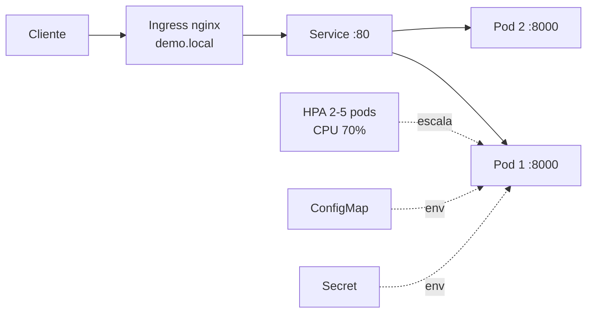

# Demo DevOps - Node.js

API de usuarios (Express + Sequelize + SQLite) dockerizada, con pipeline CI/CD en GitHub Actions y despliegue en Kubernetes.

## Arquitectura




## Ejecutar en local

```bash
cp .env.example .env
npm ci
npm run lint
npm run test:coverage
npm start            # http://localhost:8000/health
```

## Docker

```bash
docker build -t devsu-demo .
docker run -p 8000:8000 devsu-demo
# o
docker compose up --build
```

Decisiones: imagen multi-stage basada en `node:18-alpine`, solo dependencias de produccion, ejecucion con usuario **no root** (`node`), puerto y base configurables por variables de entorno y `HEALTHCHECK` contra `/health`.

## Kubernetes (minikube)

```bash
minikube start
minikube addons enable ingress
minikube addons enable metrics-server
kubectl apply -f k8s/namespace.yaml
kubectl apply -f k8s/
kubectl -n devsu-demo get pods
echo "$(minikube ip) demo.local" | sudo tee -a /etc/hosts
curl http://demo.local/health
```

Recursos: Namespace, ConfigMap, Secret, Deployment (2 replicas, RollingUpdate, probes, requests/limits), Service, Ingress y HPA (2 a 5 replicas por CPU).

## Pipeline (`.github/workflows/ci.yml`)

| Etapa | Que hace |
|---|---|
| Code build | `npm ci` |
| Static analysis | ESLint |
| Unit tests + coverage | Jest (`npm run test:coverage`) |
| Docker build & push | Imagen a GitHub Container Registry |
| Vulnerability scan | Trivy |
| Deploy | minikube efimero en el runner, `kubectl apply` y `rollout status` |

## Cambios hechos al codigo base

- Puerto configurable (`PORT`) y log corregido.
- `sequelize.sync({ force: true })` reemplazado por `sync()` para no borrar datos en cada arranque.
- SQLite ahora usa la opcion `storage` (antes `host`, que se ignoraba y dejaba la base en memoria).
- Nuevo endpoint `GET /health` con su test.
- `dotenv` movido a `dependencies` (se importa en runtime y fallaba en la imagen de produccion).
- `.env` fuera del repositorio; se incluye `.env.example`.

## Requerimientos no cumplidos y por que

- **SQLite con 2 replicas:** cada pod tiene su propio archivo (`emptyDir`), por lo que los datos no se comparten entre replicas. Se eligio para mantener la solucion simple. En produccion se debe usar PostgreSQL (servicio administrado o StatefulSet) y un Secret real para las credenciales.
- **Entorno publico e IaC (Terraform):** no se implementaron; el despliegue es local en minikube.
- **TLS/DNS:** el Ingress usa HTTP con `demo.local`. En produccion se agregaria cert-manager + Let's Encrypt y un dominio real.
- **Secret en el repositorio:** solo contiene valores de ejemplo; en produccion usar Sealed Secrets, External Secrets o Vault.

## API
These services can perform,

#### Create User

To create a user, the endpoint **/api/users** must be consumed with the following parameters:

```bash
  Method: POST
```

```json
{
    "dni": "dni",
    "name": "name"
}
```

If the response is successful, the service will return an HTTP Status 200 and a message with the following structure:

```json
{
    "id": 1,
    "dni": "dni",
    "name": "name"
}
```

If the response is unsuccessful, we will receive status 400 and the following message:

```json
{
    "error": "error"
}
```

#### Get Users

To get all users, the endpoint **/api/users** must be consumed with the following parameters:

```bash
  Method: GET
```

If the response is successful, the service will return an HTTP Status 200 and a message with the following structure:

```json
[
    {
        "id": 1,
        "dni": "dni",
        "name": "name"
    }
]
```

#### Get User

To get an user, the endpoint **/api/users/<id>** must be consumed with the following parameters:

```bash
  Method: GET
```

If the response is successful, the service will return an HTTP Status 200 and a message with the following structure:

```json
{
    "id": 1,
    "dni": "dni",
    "name": "name"
}
```

If the user id does not exist, we will receive status 404 and the following message:

```json
{
    "error": "User not found: <id>"
}
```

If the response is unsuccessful, we will receive status 400 and the following message:

```json
{
    "errors": [
        "error"
    ]
}
```
